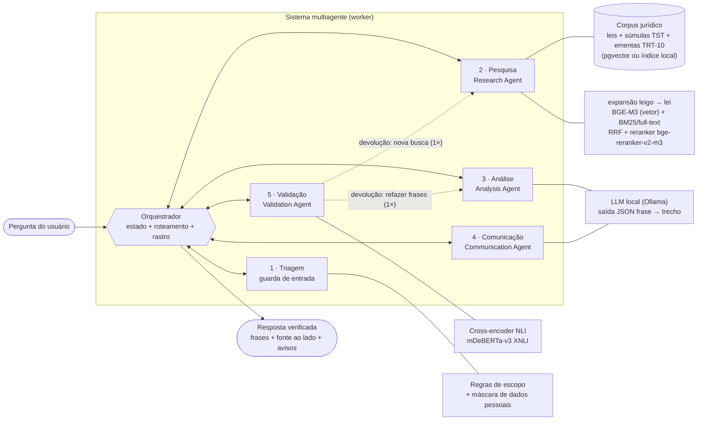
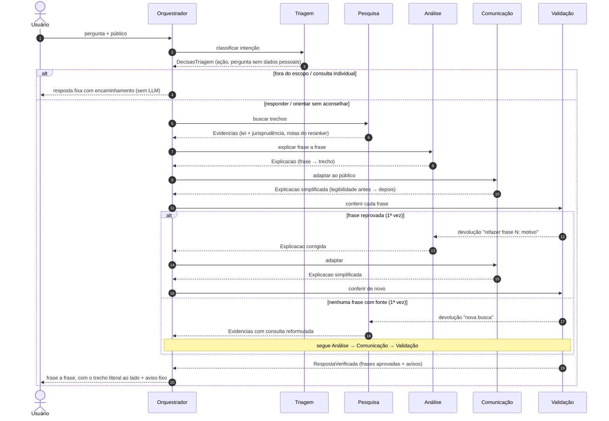

# Lexai — Primeiro protótipo multiagente

**Entrega:** 20/11/2026 · **Equipe:** Felipe (Eng. de ML/MLOps), Laisa (Cientista de dados e Curadoria jurídica), Mayara (Eng. de IA/LLM), João (Eng. de software), Davi (Eng. de dados)

O Lexai ajuda trabalhadores a entender seus processos trabalhistas sem substituir a orientação jurídica. Neste protótipo, **seis componentes — um orquestrador e cinco agentes especializados** — colaboram para responder a uma pergunta sobre direitos trabalhistas. Cada frase da resposta aponta o trecho de lei ou jurisprudência que a sustenta e só chega ao usuário depois de passar por um agente de validação.

## 1. Princípios que orientam o desenho

1. **Explica, não aconselha.** Nenhum agente diz o que a pessoa deve fazer.
2. **Toda frase tem origem.** O Agente de Análise liga cada frase a um trecho; o Agente de Validação confere essa ligação.
3. **O verificador é o último portão.** O Agente de Comunicação simplifica a linguagem *antes* da validação. Assim, a simplificação também é conferida.
4. **Responsabilidades separadas e mensagens tipadas.** Cada agente escreve só a parte do estado pela qual responde. Toda troca vira uma `Mensagem` registrada no rastro.
5. **Tudo local.** A LLM roda no Ollama e os modelos (BGE-M3, reranker, NLI) rodam no próprio Mac. Nenhum texto sai da máquina.

## 2. Arquitetura dos agentes



| Componente | Código | Modelo / técnica |
|---|---|---|
| Orquestrador | `worker/evidencia/agentes/orquestrador.py` | Máquina de estados própria (sem framework de agentes) |
| Triagem | `worker/evidencia/agentes/triagem.py` | Regras de `worker/evidencia/guardas.py` (herdadas do lex_clt.ai, 0,84 de acerto em "segue ou não segue" no teste) |
| Pesquisa | `worker/evidencia/agentes/pesquisa.py`, `expansao.py`, `buscadores.py` | Expansão leigo → termos da lei; BM25/full-text + BGE-M3 → RRF (k=60) → bge-reranker-v2-m3; cota por tipo de fonte; leis do LawCodex + recorte de jurisprudência (`corpus/jurisprudencia/`) |
| Análise | `worker/evidencia/agentes/analise.py`, `prompts/analise/v2.md` | LLM local com saída estruturada (JSON Schema) |
| Comunicação | `worker/evidencia/agentes/comunicacao.py`, `prompts/comunicacao/v2.md` | LLM local + glossário + Flesch adaptado ao português |
| Validação | `worker/evidencia/agentes/validacao.py`, `worker/evidencia/verificador.py` | NLI cross-encoder por janela do trecho + regras de saída |
| Contratos | `contratos/agentes.py` | `Mensagem`, `EstadoTarefa` (grava com `para_registro()`, sem a pergunta crua), `DecisaoTriagem`, `Rastro` (Pydantic); testes em `tests/contratos/test_agentes.py` |

Versão em imagem: [`img/arquitetura.png`](img/arquitetura.png) (fonte em `img/arquitetura.mmd`).

## 3. Responsabilidades de cada agente

| Agente | Papel | Recebe | Entrega | Pode recusar ou devolver | Nunca faz |
|---|---|---|---|---|---|
| **Orquestrador** | Coordena: mantém o estado, chama o próximo agente, aplica os limites (1 reescrita, 1 nova busca), registra o rastro e publica os eventos | pergunta, público (leigo/advogado) | `RespostaVerificada` + rastro | — | Gerar conteúdo jurídico |
| **Triagem** | Classifica a intenção (responder, orientar sem aconselhar, fora do escopo, consulta individual, institucional, outra jurisdição); mascara CPF, processo, e-mail e telefone; remove tentativas de injeção | pergunta crua | `DecisaoTriagem` | Encerra o fluxo com resposta fixa e encaminhamento (advogado, Defensoria, sindicato), **sem chamar a LLM** | Responder a pergunta |
| **Pesquisa** | Acrescenta à consulta os termos da lei equivalentes às palavras da pessoa (só na 1ª busca); busca híbrida no corpus jurídico com cota por tipo de fonte (lei e jurisprudência); descarta abaixo do limiar; reformula a consulta quando a Validação pede | consulta sanitizada | `Evidencias` (trechos com fonte, versão, nota do reranker) | Sinaliza "sem fonte segura" | Interpretar ou resumir |
| **Análise** | Sintetiza as evidências numa explicação de 3 a 7 frases, cada uma ligada ao trecho que a sustenta; na devolução, reescreve as frases reprovadas usando o motivo | `Evidencias` + pergunta | `Explicacao` (frase → `trecho_id`) | Declara que não há fonte suficiente | Usar conhecimento fora das evidências; dar conselho |
| **Comunicação** | Adapta cada frase ao público: leigo (frases curtas, termos explicados pelo glossário) ou advogado (técnico e direto); mede a legibilidade | `Explicacao` | `Explicacao` simplificada (mesma ordem e mesmo trecho) | Mantém a frase original se a reescrita falhar | Acrescentar fatos, números ou frases |
| **Validação** | Último portão: confere cada par (frase, trecho citado) com NLI (sustenta, contradiz ou não trata) e com regras (sem fonte, "você deve", promessa de resultado, dado pessoal) | `Explicacao` + `Evidencias` | `RespostaVerificada` (só frases aprovadas + avisos + versões dos modelos, do prompt e do índice) | **Devolve** à Análise (refazer frases, 1×) ou à Pesquisa (nova busca, 1×); depois remove o que segue reprovado e avisa | Reescrever frases ela mesma |

## 4. Fluxo de interação e colaboração



Versão em imagem: [`img/sequencia.png`](img/sequencia.png) (fonte em `img/sequencia.mmd`).

**Limites que garantem término:** no máximo uma reescrita e uma nova busca por pergunta, e no máximo 12 passos. Se algo continuar reprovado, sai da resposta e entra um aviso de incerteza (RNF04).

**Formato das mensagens** (`contratos/agentes.py`):

```json
{"ordem": 9, "de": "validacao", "para": "analise", "tipo": "devolucao",
 "resumo": "1 aprovadas, 1 reprovadas → devolve à Análise para reescrever as frases [1]",
 "motivo": "frase 1: o trecho contradiz a frase (p_sustenta=0.02)",
 "dados": {"julgamento": [{"ordem": 1, "aprovada": false, "nli": {"sustenta": 0.02, "contradiz": 0.9}}]},
 "ms": 412.0}
```

Tipos: `pedido` (orquestrador → agente), `resultado` (agente → orquestrador), `devolucao` (validação → agente que refaz) e `aviso` (ex.: pesquisa sem fonte segura).

## 5. Demonstração

```bash
uv sync --group worker && uv run --group treino dvc pull dados/processed   # artigos de lei
ollama pull qwen3:8b                                                        # ou outro modelo local
uv run --group worker python -m worker.evidencia.agentes.demo \
    "Quais verbas recebo na demissão sem justa causa e em quanto tempo?" --rastro dados/output/rastro_demo.json
```

A CLI imprime o diálogo entre os agentes em tempo real, a resposta com a fonte de cada frase e salva o rastro completo. Roteiro sugerido (3 minutos):

1. **Pergunta informativa** (fluxo completo): "Quais verbas recebo na demissão sem justa causa e em quanto tempo?"
2. **Mesma pergunta para a advogada** (`--persona advogado`): a Comunicação muda o registro; as fontes são as mesmas.
3. **Aconselhamento disfarçado**: "Fui demitido grávida, devo processar a empresa?" → explica a regra geral e encaminha, sem dizer o que fazer.
4. **Fora do escopo**: "Como declaro imposto de renda?" → a Triagem encerra sem chamar a LLM.

Resultados da bateria: `avaliacao/agentes/` (ver seção 6).

## 6. Como avaliamos a colaboração

`avaliacao/agentes/rodar_bateria.py` roda as perguntas de `avaliacao/agentes/perguntas_demo.jsonl` (perguntas com fonte esperada e casos armadilha, revisados pela Curadoria) e mede:

| Métrica | O que mostra |
|---|---|
| Ação correta da Triagem | recusa correta e casos concretos encaminhados |
| Fonte esperada entre as evidências | qualidade do Agente de Pesquisa |
| % de frases aprovadas pela Validação | fidelidade da Análise e da Comunicação |
| Devoluções por pergunta | quanto os laços de colaboração foram usados |
| Legibilidade antes → depois | efeito do Agente de Comunicação |
| Tempo por agente | custo de cada etapa no MacBook M4 |

### Resultado da primeira bateria (17/11, `qwen3:8b` via Ollama, índice local, MacBook M4)

| Métrica | Valor |
|---|---|
| Perguntas | 15 (9 do conjunto de teste aprovado, 2 de demo, 4 armadilhas) |
| Ação correta da Triagem | **15/15** |
| Fonte esperada entre as evidências | 8/9 |
| Frases aprovadas na 1ª validação | 60% |
| Frases liberadas / geradas | 29/42 |
| Perguntas em que a Validação devolveu trabalho à Análise | 8 |
| Legibilidade média da resposta (Flesch PT) | 61,0 |
| Dado pessoal na resposta | 0 |
| Tempo médio por agente | Pesquisa 3,4 s · Análise 45,9 s · Comunicação 33,8 s · Validação 17,0 s |

Tabela completa por pergunta e rastros em `avaliacao/agentes/resultados/2026-11-17_qwen3-8b.{md,json}`.

**O que a bateria mostrou:**

- **Os laços de colaboração foram usados de verdade.** Em 8 de 15 perguntas, a Validação devolveu frases à Análise. As frases que continuaram sem apoio saíram da resposta com aviso de incerteza. Nenhuma frase chegou ao usuário sem passar pelo verificador.
- **A Triagem acertou todos os desvios:** fora do escopo, outra jurisdição, consulta individual e caso concreto. Nessas perguntas a LLM não foi chamada.
- **A Pesquisa errou a demo_01.** Para "verbas na demissão e em quanto tempo", o art. 477 da CLT (prazo de pagamento) não entrou entre os 3 primeiros. Isso vai para o ajuste do buscador (cota maior por fonte ou recorte de jurisprudência).
- **Revisão jurídica pendente:** na armadilha da gestante, a resposta não trouxe a estabilidade (art. 391-A da CLT e art. 10 do ADCT). Uma frase sobre salário-maternidade simplifica demais quem paga o benefício. A Curadoria revisa antes da demo.
- **O gargalo de tempo é a LLM** (Análise e Comunicação). Reescrever só as frases devolvidas, e não a explicação inteira, é a próxima otimização.

Os testes de `tests/agentes/` (24 desde 19/11) usam agentes simulados e rodam no CI. Eles cobrem a ordem do fluxo, a recusa sem LLM, a máscara de dados pessoais, a devolução e a correção, a remoção com aviso, o bloqueio de conselho, a nova busca, o término dos laços e a preservação do trecho pela Comunicação.

### Ajustes de 19/11 (pendências do PR #55)

| Pendência | O que mudou | Evidência |
|---|---|---|
| Art. 477 fora do topo da demo_01 | Expansão da consulta (palavras da pessoa → termos da lei), reranker lendo a janela relevante de artigos longos, súmula priorizada sobre ementa, ADCT com rótulo próprio | Recuperação sem LLM: **10/11** perguntas com todas as fontes esperadas (8/11 sem a expansão); art. 477 em 1º na demo_01; gestante com art. 391-A, ADCT art. 10 e Súmula 244 (`avaliacao/agentes/resultados/2026-11-19_recuperacao.md`) |
| Jurisprudência no buscador local | Recorte anonimizado: 349 súmulas vigentes do TST + 203 ementas do TRT-10 (`corpus/jurisprudencia/`) | Relatório de anonimização com contagens; teste sem resíduo de CPF, CNPJ, processo e e-mail |
| Prompts | `analise/v2` e `comunicacao/v2` (todas as partes da pergunta; regra de categoria só quando perguntada; manter responsável e condição) | A medir na próxima bateria com LLM |
| Limiar do NLI | Pares-ouro v1 (105 pares) + regra de números e prazos antes do NLI; limiar 0,5 → **0,75** | Precisão 0,83 → 0,875 com recall 0,65 → 0,62 (`…_calibracao_nli.md`). O portão de 0,90 não foi atingido |
| Revisão jurídica | As 29 frases liberadas avaliadas e `pontos_esperados` escritos para demo_* e arm_* | `avaliacao/agentes/revisao_curadoria_2026-11-19.md` (aguarda aceite da Laisa) |
| Contrato e diagramas | Testes do contrato, `para_registro()` sem a pergunta crua, PNGs | `tests/contratos/test_agentes.py`, `img/*.png` |

### Ajustes de 24/11 — Agente de Validação (Eng. de ML, issue #52)

Medido com `avaliacao/agentes/calibrar_nli.py` nos mesmos 105 pares-ouro v1, com a Validação completa (regras + NLI). Relatórios em `avaliacao/agentes/resultados/2026-11-24_calibracao_nli_*.md`.

| Configuração | Limiar | Precisão | Recall | Portão 0,90 |
|---|---:|---:|---:|---|
| 19/11: janelas de 1.200 caracteres + regra de números no artigo | 0,75 | 0,875 | 0,618 | não |
| B: janela por dispositivo (caput, cada parágrafo e inciso com o começo do caput) | 0,90 | 0,900 | 0,794 | sim |
| C: B + sobreposição lexical ≥ 0,2 | 0,90 | 0,915 | 0,794 | sim |
| **E: C + número conferido no dispositivo que sustenta a frase (em uso)** | **0,55** | **0,912** | **0,912** | **sim** |

O que cada mudança corrige:

1. **Janela por dispositivo.** O mDeBERTa foi treinado com premissas curtas. Contra o artigo inteiro, ele não reconhecia nem a cópia literal de um parágrafo (p_sustenta = 0,00 no § 3º do art. 23 da LC 150; 0,95 contra o parágrafo sozinho). Agora cada parágrafo e inciso vira uma janela com o começo do caput, e vale a que mais sustenta a frase. O artigo inteiro continua entre as janelas, porque sem ele as frases que juntam caput e parágrafo perdem apoio. Quando a primeira linha é só "Art. 473", ela se junta ao caput.
2. **Sobreposição lexical ≥ 0,2.** É um sinal independente do NLI. Barra a frase que o NLI aprova, mas que generaliza o trecho com palavras que ele não usa.
3. **Número na janela de apoio.** O número trocado quase sempre existe em outro inciso do mesmo artigo ("5 dias" do nascimento numa frase sobre casamento, que é 3). A regra de números de 19/11 continua valendo para o artigo inteiro e, agora, também para o dispositivo que o NLI escolheu.
4. **NLI em lote e na GPU.** A montagem passa a usar `mps` por padrão. Com o NLI na CPU, as janelas por dispositivo levavam a Validação a 85 s por pergunta. No MPS, em lote ordenado por tamanho, 10 frases contra o art. 473 (20 janelas) levam 8 s.

**Na bateria de 24/11** (prompts v2, recorte de jurisprudência que a branch já carrega por padrão), foram liberadas 34 de 46 frases (74%; eram 69% em 17/11), com 75% de aprovação na 1ª validação (60% em 17/11). A Validação levou 9,4 s por pergunta (17,0 s em 17/11). Das 12 frases removidas, 3 caíram pela sobreposição lexical, todas paráfrases leigas do art. 462 no q_test_02, e ao menos uma está correta. Também seguem reprovadas pelo NLI frases corretas sobre o aviso prévio proporcional (demo_02) e a Súmula 244 (arm_01). As cinco vão para os pares-ouro v2. Resultado completo em `avaliacao/agentes/resultados/2026-11-24_qwen3-8b_analise-v2.md`.

**Ressalvas.** O limiar foi escolhido e medido nos mesmos 105 pares, sem conjunto separado, então a precisão real tende a ser um pouco menor. Nos 38 pares adversariais a precisão é 0,58: negação ("as gorjetas não fazem parte da remuneração") e número trocado quando a janela vencedora é o artigo inteiro ainda passam. Um par segue em discussão para a Curadoria: `bat17-49`, que explica "sem justa causa" como "falta grave" (glossário invertido). Ele está rotulado como *sustenta*, mas a revisão de 19/11 sugeriu *não trata*.

### Memória e latência no MacBook M4

Medido em 24/11 com `python -m treino.medir_memoria_latencia`, com BGE-M3, reranker, NLI e BERTimbau no mesmo processo e a LLM no Ollama na configuração da entrega (`qwen3:8b` Q4_K_M, `num_ctx=16384`). Relatório: [`treino/relatorios/memoria_latencia_m4.md`](../../treino/relatorios/memoria_latencia_m4.md).

| Item | Medida |
|---|---:|
| LLM no Ollama | 7,3 GB |
| Modelos de ML juntos (pico) | 7,4 GB |
| **Worker total** | **14,7 GB** de 16 disponíveis (24 GB − 8 GB para macOS, Docker e navegador) |
| 1º token com contexto novo (~2,5 mil tokens) | 16–24 s (prefill ~105 tok/s) |
| Geração | ~12 tok/s |

Cabe, mas a folga é de 1,3 GB. Com `num_ctx=8192` a LLM ocupa 5,5 GB (medição de 19/11) e os prompts da bateria ficam em ~2,5 mil tokens: é a folga mais barata, se o grupo precisar. Com a `qwen3:8b-q8_0` do `.env.example` (~9 GB), não cabe. Para a demo, use `LLM_MODELO=qwen3:8b`.

## 7. Limitações e próximos passos

- A Triagem ainda usa regras; o classificador de intenção (BERTimbau) chega na Semana 4 pelo Eng. de ML.
- O verificador atinge o portão de precisão 0,90 nos pares-ouro v1 desde 24/11 (0,912 / 0,912), mas com limiar escolhido nesses mesmos pares e precisão de 0,58 nos adversariais (negação e número trocado ainda passam). Próximos passos: pares-ouro revisados pela Curadoria com um conjunto separado para medir; benchmark de outros cross-encoders NLI nos mesmos pares.
- A bateria com os prompts v2 ainda precisa rodar no MacBook (`rodar_bateria --modelo qwen3:8b`).
- A arm_03 (prazo do FGTS) não traz o art. 477 entre as 3 leis; traz os arts. 18 e 20 da Lei 8.036.
- O índice local cobre as 25 normas do LawCodex e o recorte de jurisprudência; o livro de súmulas é de 2018.
- Os laços reexecutam a Comunicação inteira; dá para reescrever só as frases devolvidas.
- Próximo passo: o mesmo orquestrador já roda dentro do worker (`worker/pipelines.py::responder_pergunta`) e publica cada frase aprovada por SSE para o app.
